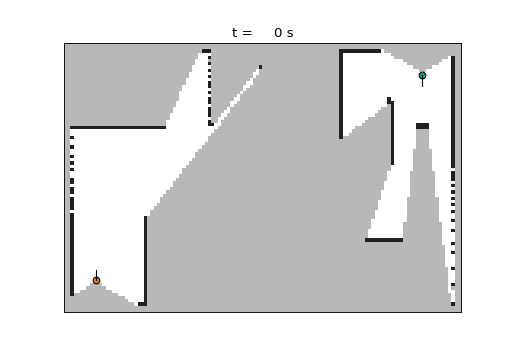
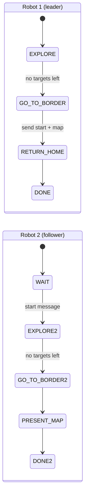
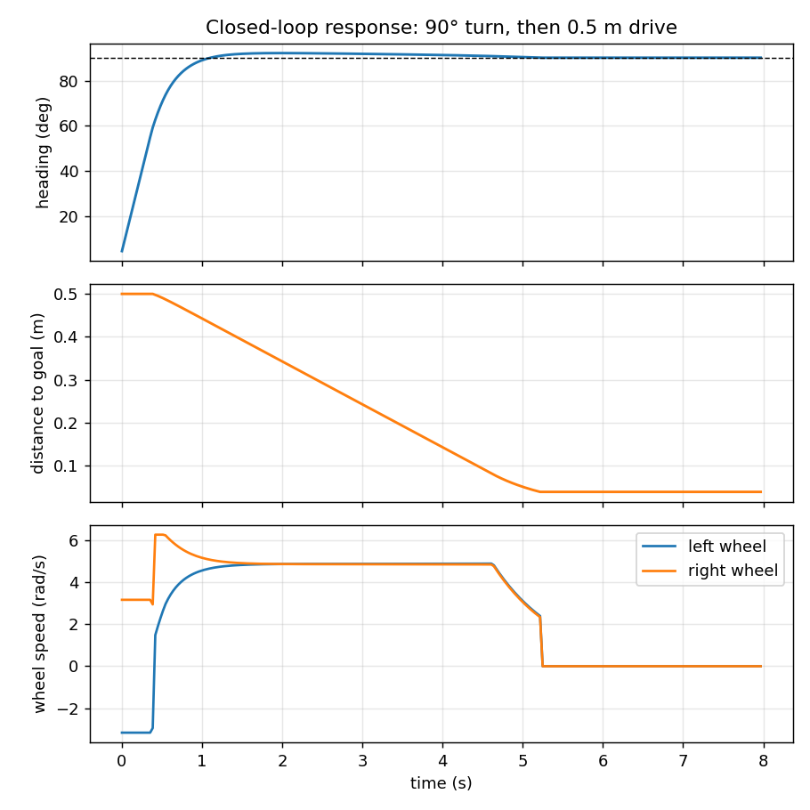
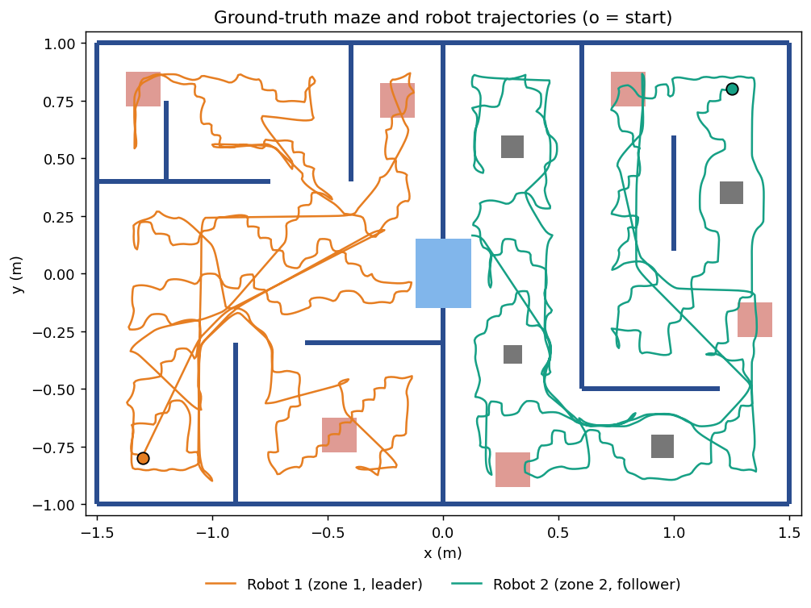
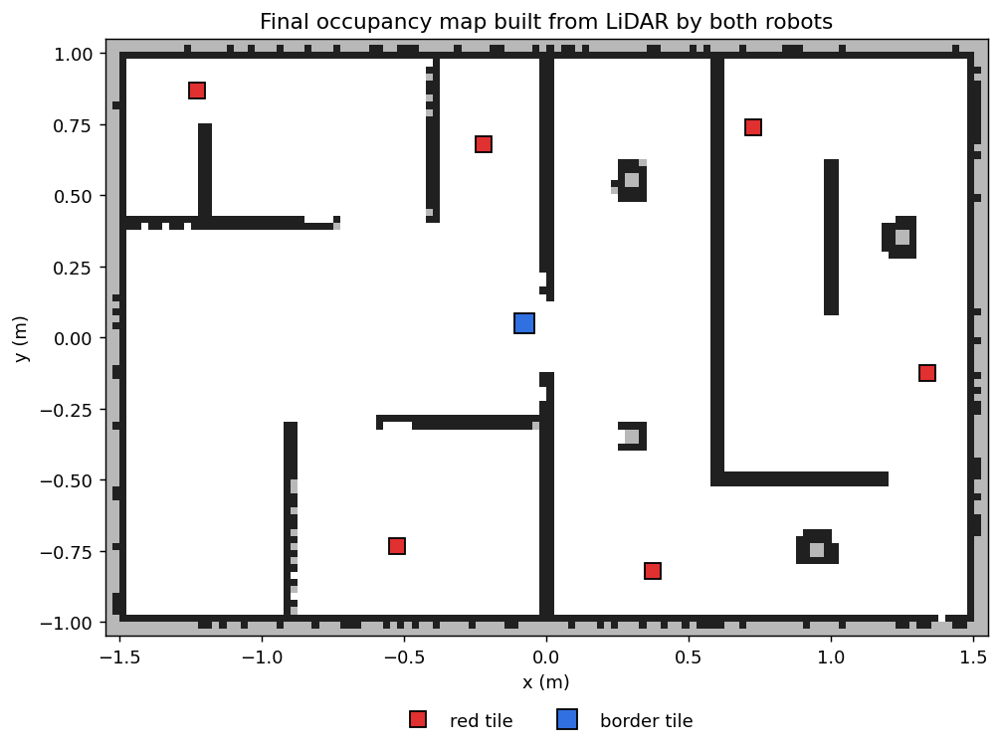

# Cooperative Maze Exploration with Two e-puck Robots

Two e-puck robots share the job of exploring a maze **without distance or proximity sensors**. They use only LiDAR, GPS, a compass and ground sensors. Each robot builds an occupancy map, explores its own zone with frontier-based exploration and A* path planning, and drives with closed-loop PID control. The robots coordinate over a radio link, and the second robot presents the merged map of the whole environment at the end.

<p align="center"></p>

> **Course:** Computer-Controlled Systems (Digital Control) Lab, final project, Amirkabir University of Technology, 2025.
> **Team:** Sepehr Ebrahimi and Mohammad Amin Zilabi. See [Credits](#credits) for who did what.

## The mission

- Two e-puck robots start in separate zones of a maze. The zones are joined by one opening, which is covered by a **blue border tile**. The robots must **never cross** it.
- **Robot 1 (leader)** explores zone 1 completely. Whenever it drives over a **red tile**, it switches on all its LEDs and prints a message. Afterwards it goes to the border and notifies robot 2. For the bonus, it then returns to its starting point.
- **Robot 2 (follower)** waits for that signal. It then explores zone 2, which also contains box obstacles that it must avoid **without collision**, handles red tiles in the same way, and returns to the border to present the complete map.
- **Constraints:**
  - Distance sensors and proximity sensors are forbidden. Only the LiDAR, compass, GPS and ground sensors may be used.
  - The maze size and the starting position are unknown.
  - **All motion must be closed-loop.** Delays and open-loop manoeuvres are not allowed.
  - A general, explicitly discretised PID controller must be written and reused.

## Architecture

```
maze_explorer/            hardware-independent algorithms (pure Python + NumPy)
├── occupancy_grid.py     log-odds LiDAR mapping, map serialisation and merging
├── planning.py           A*, clearance cost, path smoothing, frontier/coverage targets
├── pid.py                discrete PID (Tustin integral, filtered derivative, anti-windup)
├── motion.py             two-loop waypoint follower for a differential drive
├── explorer.py           mission state machine (leader / follower)
└── config.py             all tunable parameters
controllers/              Webots controllers (thin wrappers around MazeExplorer)
├── zone1_leader/
└── zone2_follower/
sim/                      offline 2-D simulator with a Webots-compatible device API
tests/                    unit tests and an end-to-end mission test
```

The Webots controllers are three lines of logic: `explorer.update()` once per `robot.step()`. Everything else lives in `maze_explorer`, which only touches the Webots device API. The offline simulator in `sim/` provides devices with the same API, so **exactly the same code** runs in Webots and on a laptop without Webots. That is how all the results below were produced and tested.



## Methods

### 1. Mapping: log-odds occupancy grid
The map is a 2.5 cm grid. For every LiDAR ray, the cells it passes through are evidence of free space, and the cell where it ends is evidence of an obstacle. The evidence is accumulated in **log-odds** form:

$$l_{k}(m) = l_{k-1}(m) + \begin{cases} l_\text{occ} = +0.9 & \text{ray ends in } m \\ l_\text{free} = -0.4 & \text{ray passes through } m \end{cases}$$

The values are clamped to $[-4, 4]$ so the map can still adapt. A cell counts as occupied when $l > 0.8$ and as free when $l < -0.3$. The pose comes from GPS (x, y) and the compass (heading $\theta = \operatorname{atan2}(c_x, c_y)$). Ray $i$ of the LiDAR's left-to-right range image points at $\theta + \frac{\text{FOV}}{2} - i\frac{\text{FOV}}{n-1}$. All of this is vectorised in NumPy.

### 2. Exploration: frontiers plus floor coverage
LiDAR mapping alone is not enough. A room can be fully mapped from its doorway, but **red tiles can only be detected by the ground sensors under the robot**. The planner therefore chooses targets from two sources:
- **Frontiers.** These are free cells next to unknown cells, grouped into 8-connected clusters, with tiny clusters treated as noise. The robot only needs to get within 5 cm of a frontier to observe it.
- **Unswept floor.** Every free cell that the ground sensors have not passed within 7 cm of is also a target.

The target with the **shortest BFS path** from the robot is chosen. Targets are re-evaluated every second, and targets that turn out to be unreachable are blacklisted. Exploration ends when no target is left.

### 3. Path planning: A*
- **Search.** 8-connected A* with the octile-distance heuristic. Diagonal moves may not cut obstacle corners.
- **Inflation.** Obstacles are grown by the robot radius to give a configuration-space map.
- **Clearance cost.** An extra cost that decays linearly away from obstacles keeps paths in the middle of corridors. The heuristic stays admissible because the extra cost is never negative.
- **Path smoothing.** Line-of-sight checks reduce the path to a few waypoints. A shortcut is only allowed through cells with full clearance.
- **Escaping blocked areas.** If the robot stands inside an inflated or forbidden margin, for example right after detecting the border, it first plans to the nearest safe cell.

### 4. Control: discrete PID and waypoint following
`pid.py` implements one general PID that is reused for both control loops. It is discretised with sample time $T_s$ (one Webots time step):

$$u[k] = K_p e[k] + I[k] + D[k]$$

$$I[k] = I[k-1] + K_i \frac{T_s}{2}\big(e[k] + e[k-1]\big) \qquad \text{(Tustin / trapezoidal)}$$

$$D[k] = \frac{T_f}{T_f + T_s} D[k-1] + \frac{K_d}{T_f + T_s}\big(e[k]-e[k-1]\big) \qquad \text{(backward Euler of } \tfrac{K_d s}{T_f s + 1}\text{)}$$

The output is saturated. **Anti-windup** comes from conditional integration: the integrator is frozen while the output is saturated in the direction of the error.

The waypoint follower runs two loops:
- **Heading loop.** The error is the bearing to the waypoint minus the robot heading, and the output is the angular velocity ω.
- **Distance loop.** The error is the remaining path length, and the output is the linear velocity v. It is scaled by cos(heading error) and set to zero above 0.6 rad, so the robot turns on the spot first.

(v, ω) is then converted to wheel speeds, and both wheels are scaled together if either would exceed the motor limit. A LiDAR safety filter also cancels forward motion if something appears within 6 cm in front.

<p align="center"></p>

### 5. Coordination and the border
- **Detecting the border.** When at least 2 of the 3 ground sensors read the blue tile, the robot marks a 15 cm no-go disc around it in its map and replans. From then on, A* cannot plan across the border.
- **Hand-over message.** At the border, the leader sends a single radio packet with a JSON header (`start`, border position, red tiles found) followed by its **whole map**, compressed to int8 log-odds plus a bit-packed no-go mask.
- **Follower start.** The follower merges that map into its own, keeping the more confident estimate for each cell. It therefore knows about the border before it moves, and at the end it presents a single map of **both zones**.

## Results (offline simulator)

The simulated world mirrors the course setup: a 3 m × 2 m maze, two zones joined through a blue border tile, 6 red tiles and 4 box obstacles in zone 2. The LiDAR model is a Hokuyo URG-04LX (667 rays over 240°, 4 m range, Gaussian noise), and the robot uses e-puck kinematics with a 32 ms control step.

| Ground truth and trajectories | Final map presented by robot 2 |
|---|---|
|  |  |

**Benchmark over 10 runs with different sensor-noise seeds** (`python -m sim.benchmark`):

| Seed | Mission time (s) | Map coverage | Red tiles (zone 1, zone 2) | Collisions | Border crossed | Robot 1 returned home |
|---:|---:|---:|:---:|---:|:---:|:---:|
| 0 | 699 | 89.7% | 3/3, 3/3 | 0 | no | yes |
| 1 | 683 | 89.7% | 3/3, 3/3 | 0 | no | yes |
| 2 | 671 | 90.0% | 3/3, 3/3 | 0 | no | yes |
| 3 | 678 | 89.7% | 3/3, 3/3 | 0 | no | yes |
| 4 | 678 | 90.0% | 3/3, 3/3 | 0 | no | yes |
| 5 | 671 | 89.8% | 3/3, 3/3 | 0 | no | yes |
| 6 | 673 | 90.0% | 3/3, 3/3 | 0 | no | yes |
| 7 | 678 | 89.7% | 3/3, 3/3 | 0 | no | yes |
| 8 | 700 | 89.5% | 3/3, 3/3 | 0 | no | yes |
| 9 | 712 | 89.6% | 3/3, 3/3 | 0 | no | yes |

**All 10 runs:** every red tile found, zero collisions, the border never crossed, and robot 1 back home. Mean mission time 684 s (simulated), mean map coverage 89.8%. The roughly 10% of cells that stay unmapped are mostly inside wall thickness and behind obstacles, where no LiDAR ray can reach.

## Running it

**Offline (no Webots needed):**
```bash
pip install -r requirements.txt
python -m sim.run_simulation --gif      # full mission, writes docs/*.png and docs/exploration.gif
python -m sim.benchmark --runs 10       # robustness over several noise seeds
python -m sim.pid_response              # controller step response
python -m unittest discover -s tests -v # 16 unit tests + end-to-end mission test (~1 min)
```

**In Webots (R2023b):** copy `controllers/` and `maze_explorer/` into your Webots project folder (the one that contains `worlds/`), then set the two e-puck controllers to `zone1_leader` and `zone2_follower`. Each robot needs:
- a LiDAR named `Hokuyo URG-04LX`
- `gps`
- `compass`
- ground sensors `gs0`–`gs2`
- the leader an `emitter`, and the follower a `receiver`, on channel 1

Device names, map limits and thresholds are in [`maze_explorer/config.py`](maze_explorer/config.py).

## Changes compared with the original course submission

The original controllers (two ~500-line scripts) worked as a course demo but had several problems. Rebuilding the project for this portfolio fixed them:

| Original | Now |
|---|---|
| The "A*" cleared its open list every step, so it was really greedy best-first search, and it planned through unknown space one cell at a time. | Full A* on the inflated map, with a clearance cost and path smoothing. |
| Frontier search kept only one frontier per grid column (a misplaced `break`). | Clustered frontiers plus floor-coverage targets, selected by BFS path length. |
| Robot 1 stopped wherever it first touched the blue tile, not when exploration was actually finished. | The border is recorded as a no-go area, and the robot hands over only after it has run out of targets. |
| Robot 2 compared `receiver.getData()` (bytes) to the string `"start"`, which is always false in Python 3. | Typed message with the map and the border position. |
| The return-home bonus crashed (it indexed a float and used an undefined name). | Return home with A*, verified in every benchmark run. |
| The PID had no anti-windup and no discretisation of its own (`dt = 1`). | Tustin integral, filtered derivative, conditional anti-windup, and unit tests. |
| Two copy-pasted scripts, ~150 lines of dead or debug code, no tests. | One shared package, two thin controllers, a simulator, and 21 tests. |

## Limitations and future work
- The original course world file was not part of the submission archive, so this version has been validated in the offline simulator, not yet in Webots itself. The device API and conventions follow Webots R2023b (ENU world), and the ground-sensor thresholds are the ones calibrated in the original world.
- Coverage is greedy (nearest unswept patch), which makes the paths wiggly. A boustrophedon ("lawnmower") sweep of each room would shorten the mission.
- Localisation relies on GPS. Replacing it with LiDAR scan matching would turn this into a full SLAM system.

## Credits
- **Original submission (2025):**
  - **Sepehr Ebrahimi**: A* path planning and LiDAR mapping and visualisation.
  - **Mohammad Amin Zilabi**: frontier-based exploration, the PID controller, robot-to-robot communication and the LED handling.
- **This version (2026):** a refactor and extension by **Sepehr Ebrahimi**: the shared package, the new mapping, planning, control and coordination design, the offline simulator and the tests.

## Skills
Mobile robotics · occupancy-grid mapping · frontier exploration · A* path planning · discrete-time PID design · multi-robot coordination · Webots · Python and NumPy · simulation and testing

## Author
**Sepehr Ebrahimi**, B.Sc. Electrical Engineering, Amirkabir University of Technology (2026)
